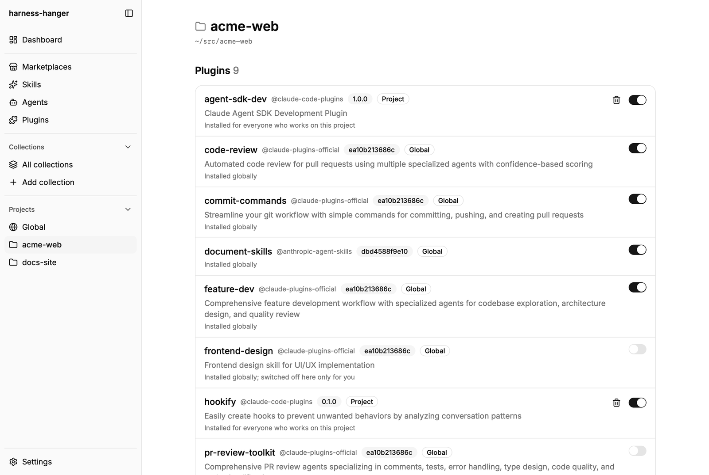
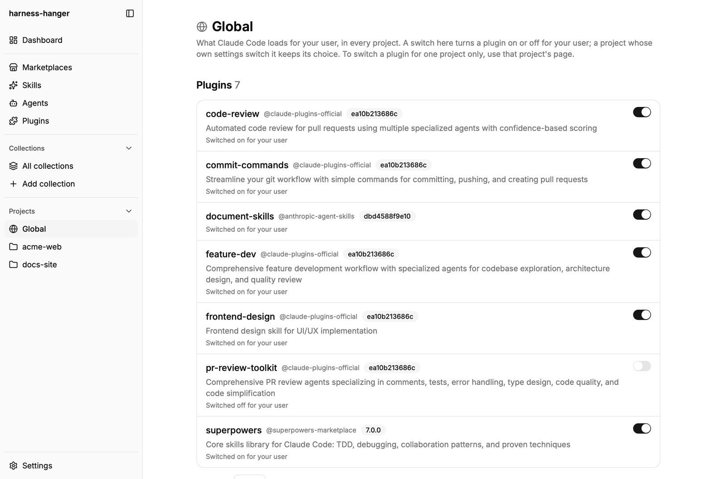
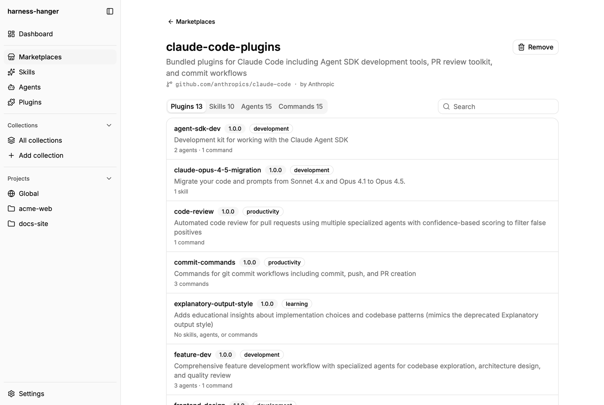
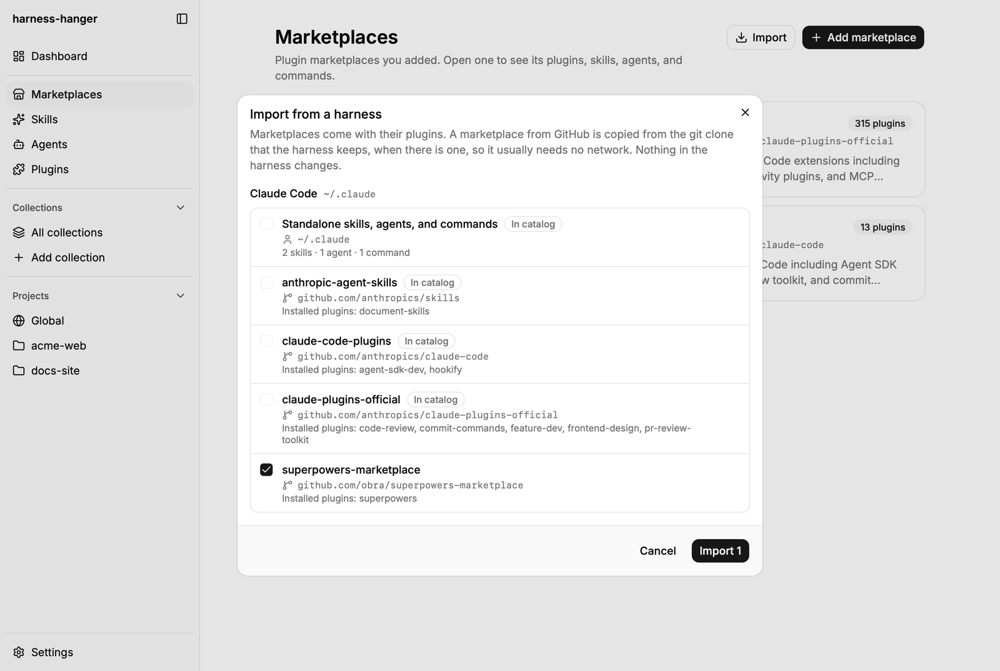
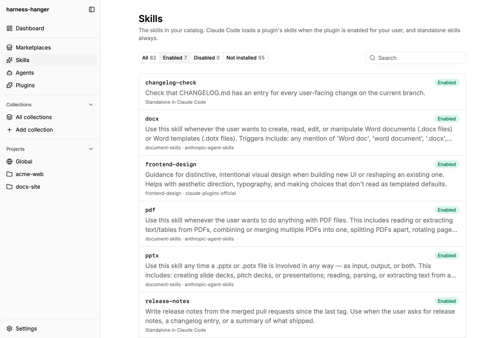
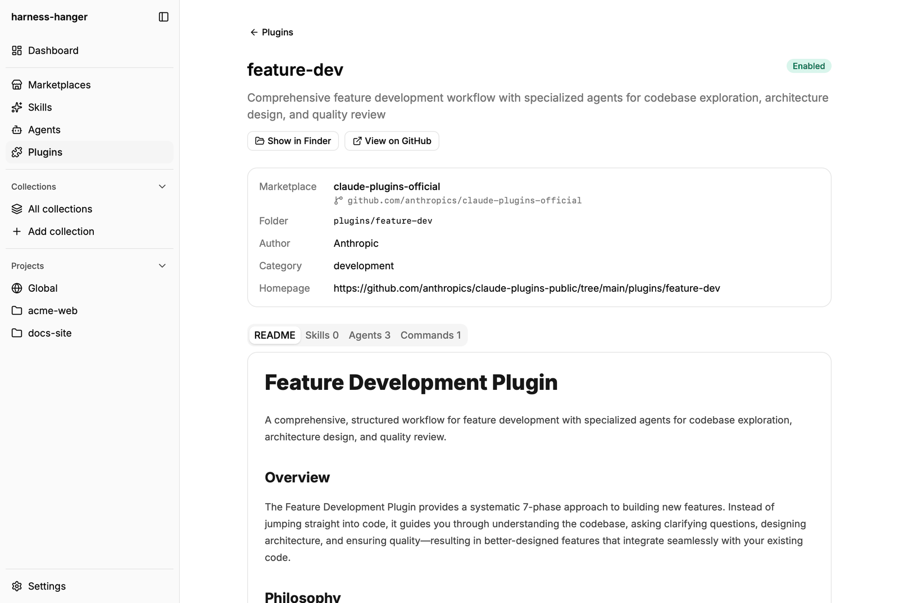
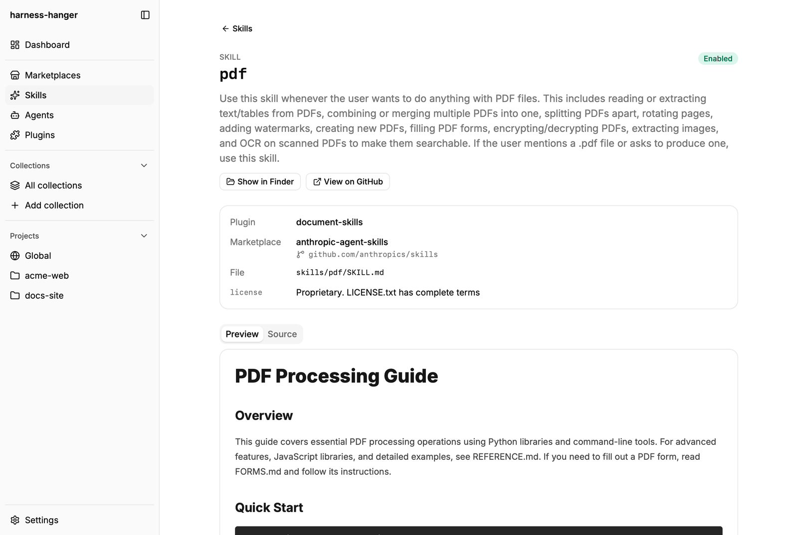
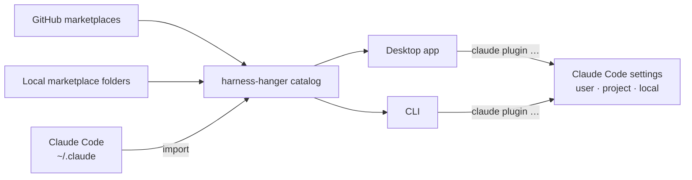

<h1 align="center">harness-hanger</h1>

<p align="center">
  One place to see and manage what your AI coding harness loads: skills, agents, commands,
  plugins, and the marketplaces they come from.
</p>

<p align="center">
  <a href="docs/product.md">Roadmap</a>
  &nbsp;·&nbsp;
  <a href="CONTRIBUTING.md">Contributing</a>
  &nbsp;·&nbsp;
  <a href="https://github.com/ready2know/harness-hanger/issues">Issues</a>
</p>

<p align="center">
  <a href="https://github.com/ready2know/harness-hanger/actions/workflows/ci.yml"></a>
  <a href="#license"></a>
</p>

<p align="center">
  <strong>Early development.</strong> There is no release yet: build it from source.
  The CLI and the data format can still change.
</p>

<p align="center">
  <picture>
    <source media="(prefers-color-scheme: dark)" srcset="docs/screenshots/project-dark.png">
    
  </picture>
</p>

<p align="center"><strong>Global Setup</strong></p>
<p align="center">
  <picture>
    <source media="(prefers-color-scheme: dark)" srcset="docs/screenshots/global-dark.png">
    
  </picture>
</p>

<p align="center"><strong>Marketplace Preview</strong></p>
<p align="center">
  <picture>
    <source media="(prefers-color-scheme: dark)" srcset="docs/screenshots/marketplace-preview-dark.png">
    
  </picture>
</p>

<p align="center"><strong>Import from Claude Code</strong></p>
<p align="center">
  <picture>
    <source media="(prefers-color-scheme: dark)" srcset="docs/screenshots/import-dark.png">
    
  </picture>
</p>

<p align="center"><strong>Skills</strong></p>
<p align="center">
  <picture>
    <source media="(prefers-color-scheme: dark)" srcset="docs/screenshots/skills-dark.png">
    
  </picture>
</p>

<p align="center"><strong>Plugin Page</strong></p>
<p align="center">
  <picture>
    <source media="(prefers-color-scheme: dark)" srcset="docs/screenshots/plugin-dark.png">
    
  </picture>
</p>

<p align="center"><strong>Skill Page</strong></p>
<p align="center">
  <picture>
    <source media="(prefers-color-scheme: dark)" srcset="docs/screenshots/skill-dark.png">
    
  </picture>
</p>

## Features



- **Marketplace catalog** — Add marketplaces from GitHub (a URL or `owner/repo`) or from a local
  folder. GitHub sources are cloned into harness-hanger's data directory; local folders are read
  in place. The catalog belongs to harness-hanger, so adding a marketplace does not change Claude
  Code's files.
- **Discover** — Find public marketplaces on GitHub and add one in a single action, without
  cloning it first. With a GitHub token, every repository with a marketplace manifest is searched;
  without one, only repositories with the `claude-code-marketplace` topic. What earlier searches
  found stays in a local index, which later searches match by plugin names and descriptions, even
  offline.
- **Import from Claude Code** — Bring in the marketplaces that Claude Code already knows, with
  their plugins, and the skills, agents, and commands that it loads outside plugins. A GitHub
  marketplace is copied from Claude Code's own clone, so it usually needs no network. Nothing in
  Claude Code changes.
- **Marketplace preview** — Open a marketplace to see its plugins, skills, agents, and commands
  before you install anything.
- **Skills, Agents, and Plugins pages** — Everything in the catalog, one list per kind, with a
  search box and filters for enabled, disabled, and not installed. The status is what Claude Code
  has for your user.
- **A page for every component** — Each plugin, skill, agent, and command has its own page: its
  metadata, its README or file as a preview or as source, and buttons that show the file on disk
  and open it on GitHub.
- **Global page** — What Claude Code loads for your user in every project. Switch a plugin on or
  off for your user. A project whose own settings switch the plugin keeps its choice.
- **Project pages** — Add any folder as a project to see which plugins apply there, where each one
  is installed, and which settings file decides whether it is on. Switch a plugin on or off for
  one project, install a plugin from the catalog, or uninstall one. The page also lists the
  project's standalone skills, agents, and commands.
- **Changes through Claude Code's own CLI** — harness-hanger runs `claude plugin …` instead of
  editing Claude Code's files, and puts each change in the narrowest scope it can. See
  [How harness-hanger changes your setup](#how-harness-hanger-changes-your-setup).
- **CLI for scripts and agents** — The same features in the terminal. Every command prints
  machine-readable output with `--json`.
- **Local only** — No account and no telemetry. All data stays on your machine. harness-hanger
  talks to GitHub only to clone marketplaces and when you use Discover.

### Planned

- **Usage statistics** — A Claude Code hook records which skills, agents, commands, and MCP tools
  run, and whether the agent or you started each one, so you can see what you use and what is
  dead weight.
- **More of the setup** — MCP servers, permissions, instructions (CLAUDE.md, AGENTS.md, and rule
  files), and switches for skills, agents, and commands outside plugins.
- **Backlog** — Track the components you plan to build: idea, draft, published.
- **More harnesses** — Install from a marketplace into Cursor, Hermes, Codex, and pi, globally or
  for one project.
- **Collections** — Group components into a set, apply it to a project, or share it as a file.
- **Tester** — Run an agent with a prompt in a folder you choose, and check that it uses a skill
  or a subagent.
- **Workflows** — Describe a sequence of steps that use skills, agents, and plugins. Run it with
  one call, or share it as a file.

The full roadmap and the decisions behind it are in [`docs/product.md`](docs/product.md).

## Install

There are no prebuilt installers yet. Build the desktop app and the CLI from source: see
[Getting Started](#getting-started). CI builds and tests on macOS, Linux, and Windows.

## Quick Start

1. Start the app with `pnpm dev`.
2. Open **Marketplaces** and click **Import** to bring in what Claude Code already has, or click
   **Add marketplace** to add one from GitHub or from a local folder. Open **Discover** to find
   public marketplaces on GitHub.
3. Open a marketplace to preview its plugins, skills, agents, and commands.
4. Use **Skills**, **Agents**, and **Plugins** in the sidebar to browse the whole catalog. Filter by
   status to see what Claude Code has enabled.
5. Open **Settings** and add your project folders. Each one appears under **Projects** in the
   sidebar.
6. Open a project to switch plugins on or off there, install plugins from the catalog, or
   uninstall them. Open **Global** to switch plugins for your user.

## How harness-hanger changes your setup

- **Claude Code's files are the source of truth.** harness-hanger reads them directly and does not
  keep its own copy of what is installed.
- **Changes go through Claude Code's CLI.** harness-hanger runs `claude plugin …` to switch,
  install, and uninstall plugins. It does not edit Claude Code's files itself.
- **Each change goes to the narrowest place it can.** A global plugin that you switch off in a
  project is switched off only for you, in `.claude/settings.local.json`. A plugin from a GitHub
  marketplace that you install into a project goes into `.claude/settings.json`, for everyone who
  works on the project. A plugin from a local-folder marketplace goes into your own
  `.claude/settings.local.json`, because the folder exists only on your machine.
- **Its own data is separate.** The catalog, the project list, and the clones of GitHub
  marketplaces are in harness-hanger's data directory. See [Troubleshooting](#troubleshooting) for
  where it is.

## Supported Harnesses

| Harness | Status |
| --- | --- |
| Claude Code | Import, browse, and switch, install, or uninstall plugins, globally and per project |
| Cursor, Hermes, Codex, pi | Planned |

## Tech Stack

| Layer | Tech |
| --- | --- |
| Frontend | Vue 3, TypeScript, Vite, Tailwind CSS 4, shadcn-vue |
| Desktop | Tauri 2 |
| Core and CLI | Rust, clap |
| Storage | SQLite (`rusqlite`) |

## Getting Started

### Prerequisites

- Rust stable (edition 2024) with `rustfmt` and `clippy`
- Node.js 22.18+ or 24.12+, and pnpm 9
- [Tauri prerequisites](https://v2.tauri.app/start/prerequisites/) for your OS
- At run time: `git`, to clone marketplaces from GitHub, and Claude Code's `claude` command, to
  switch, install, and uninstall plugins
- Optional: a GitHub token or the `gh` command, so that Discover searches every marketplace on
  GitHub

### Development

```bash
pnpm install   # JS dependencies and git hooks
pnpm dev       # run the desktop app
```

### CLI

The CLI uses the same Rust core as the desktop app, and the same data directory.

```bash
# Fill the catalog
cargo run -p hanger-cli -- import claude-code --all                # import what Claude Code already has
cargo run -p hanger-cli -- marketplace add anthropics/claude-code  # add one or more marketplaces
cargo run -p hanger-cli -- marketplace search code review          # find public marketplaces on GitHub
cargo run -p hanger-cli -- github login                            # sign in, so search covers all of GitHub

# Look around
cargo run -p hanger-cli -- marketplace ls
cargo run -p hanger-cli -- marketplace show 4
cargo run -p hanger-cli -- marketplace plugins

# Manage a project
cargo run -p hanger-cli -- project add ~/src/acme-web
cargo run -p hanger-cli -- project install 1 hookify@claude-code-plugins
cargo run -p hanger-cli -- project disable 1 frontend-design@claude-plugins-official
cargo run -p hanger-cli -- project show 1
```

```text
Project ~/src/acme-web
  on   agent-sdk-dev@claude-code-plugins  installed for the project, set by project settings
  on   code-review@claude-plugins-official  installed for the user, set by user settings
  on   commit-commands@claude-plugins-official  installed for the user, set by user settings
  on   document-skills@anthropic-agent-skills  installed for the user, set by user settings
  on   feature-dev@claude-plugins-official  installed for the user, set by user settings
  off  frontend-design@claude-plugins-official  installed for the user, set by your own project settings
  on   hookify@claude-code-plugins  installed for the project, set by project settings
  off  pr-review-toolkit@claude-plugins-official  installed for the user, set by user settings
  on   superpowers@superpowers-marketplace  installed for the user, set by user settings
Standalone:
  skills: deploy-preview
```

Commands:

- `info` — show the version and where the Claude Code configuration is read from
- `marketplace` — `add`, `ls`, `show`, and `rm` marketplaces in the catalog; `plugins` lists the
  plugins of every marketplace and whether Claude Code has each one enabled; `search` finds public
  marketplaces on GitHub, with `--refresh` to ask GitHub again and `--offline` to ask it nothing
- `github` — `login` in the browser, or `--with-token` from standard input; `status`, `check`, and
  `logout` for the GitHub account that `marketplace search` uses
- `import` — import marketplaces and standalone components from a harness; with nothing named, it
  lists what can be imported
- `project` — `add`, `ls`, and `rm` project folders; `show` what applies in a project, or globally
  without an ID; `enable`, `disable`, `install`, and `uninstall` plugins in a project

`--help` on any command prints all of its options.

Extra flags and settings:

- `--json` — machine-readable output for scripts and agents, on every command
- `HARNESS_HANGER_DATA_DIR` — use another data directory
- `GH_TOKEN` or `GITHUB_TOKEN` — the GitHub token for `marketplace search`; it wins over the token
  in the system keychain and the login of `gh`
- `CLAUDE_CONFIG_DIR` — read Claude Code's configuration from another directory instead of
  `~/.claude`

To put the CLI on your `PATH` as `harness-hanger`:

```bash
cargo install --path crates/hanger-cli --locked
```

### Build

```bash
pnpm build                            # desktop app and installers
cargo build --release -p hanger-cli   # CLI
```

Signing in to GitHub in the browser uses harness-hanger's own OAuth App. A fork can use its own
app, with Device Flow enabled, by setting its client ID as `HARNESS_HANGER_GITHUB_CLIENT_ID` when
building.

### Repository Layout

```
crates/
  hanger-core/        Core library: discovery, harness adapters, storage
  hanger-cli/         CLI (binary: harness-hanger)
apps/
  desktop/            Desktop app: Vue 3 + TypeScript frontend
    src-tauri/        Tauri 2 shell over hanger-core
docs/
  product.md          Product brief, decisions, roadmap
  plans/              Plans for each milestone
  screenshots/        The screenshots in this README
```

## Troubleshooting

**"cannot find the claude command".** harness-hanger runs Claude Code's `claude` command to switch,
install, and uninstall plugins. Install Claude Code, or add the folder that holds `claude` to your
`PATH`.

**Discover finds only a few marketplaces.** Without a GitHub token, Discover searches only
repositories with the `claude-code-marketplace` topic. Sign in under **Settings → GitHub**, run
`harness-hanger github login`, or set `GH_TOKEN`, to search every repository with a marketplace
manifest.

**Start over.** harness-hanger keeps its own data in one directory, and Claude Code's files are not
in it. Delete the directory to clear the catalog and the project list:

| OS | Data directory |
| --- | --- |
| macOS | `~/Library/Application Support/harness-hanger` |
| Linux | `~/.local/share/harness-hanger` |
| Windows | `%LOCALAPPDATA%\harness-hanger` |

`HARNESS_HANGER_DATA_DIR` overrides it on every OS.

Anything else: [open an issue](https://github.com/ready2know/harness-hanger/issues/new/choose).

## Contributing

See [CONTRIBUTING.md](CONTRIBUTING.md) for the setup, the checks, and the commit convention.

## License

Licensed under either of

- Apache License, Version 2.0 ([LICENSE-APACHE](LICENSE-APACHE))
- MIT license ([LICENSE-MIT](LICENSE-MIT))

at your option.
